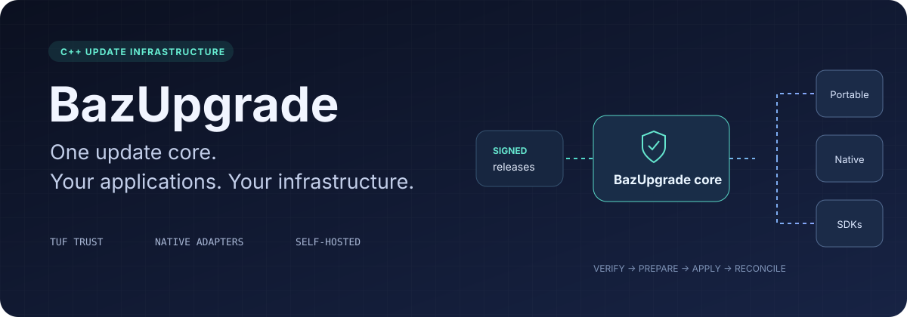

  

  
  
  
  

  <a href="docs/installation.md"><b>Install</b></a> ·
  <a href="docs/quickstart.md"><b>Try the workflow</b></a> ·
  <a href="docs/publishing.md"><b>Host updates</b></a> ·
  <a href="docs/integrations.md"><b>Integrate your app</b></a> ·
  <a href="docs/architecture.md"><b>Architecture</b></a>

# Updates belong in your infrastructure

**BazUpgrade is a C++ update engine, publisher toolkit, and application SDK.** Publish a signed repository on your own HTTPS server, select exactly which application and channel a client trusts, and apply updates through a portable installation engine or a native package adapter.

Build the update infrastructure once. Reuse its trust policy, verification, operation journal, and integrations across your applications.

## Why BazUpgrade?

| | What you get |
|---|---|
| **Trust beyond the download URL** | TUF metadata verification, Ed25519 thresholds, root rotation, expiration checks, and persistent rollback protection. |
| **An engine you can extend** | C++ interfaces for transports, crypto providers, and installers. Native adapters retain the platform's installation rules. |
| **Your server, your releases** | A static repository works over HTTPS. Signing keys stay outside the web root. No hosted account is required. |
| **Recovery with a memory** | Durable operation phases distinguish a completed update from an interrupted installer. Unknown operations require explicit reconciliation. |
| **A small integration surface** | C++ library, C ABI, JSON CLI, and a dependency-free Node/Electron main-process SDK. |
| **Explicit application boundaries** | Signed application, channel, OS, architecture, package type, and release sequence must match local policy. |

## From release to running application

~~~mermaid
flowchart LR
    A[Build your application] --> B[Pack and sign repository]
    B --> C[Your HTTPS server]
    C --> D[TUF verification]
    D --> E[Application policy]
    E --> F[Portable or native installer]
    F --> G[Durable result and recovery]
~~~

### Try it with a synthetic application

After [building the tools](docs/installation.md), run:

~~~sh
bazupgrade-publish init --repo ./repository --keys ./private-signing
bazupgrade-publish pack --directory ./application --output ./application.zip
~~~

Create a synthetic application and follow the [five-step quickstart](docs/quickstart.md) to describe, publish, verify and install it. The portable example stays in your selected local directories.

~~~text
publish          → signed repository
check            → updateAvailable
apply            → updated
check again      → upToDate
~~~

Follow the [step-by-step quickstart](docs/quickstart.md) to run each command yourself.

## One core, several integration paths

| Integration | Available in v2 | Important boundary |
|---|---|---|
| Portable ZIP / TAR application | Verified extraction into version directories; active-path state; file rollback | Application data migrations and application shutdown remain the host's responsibility. |
| Windows MSIX, MSI, NSIS | Native installer invocation and exit handling | No automatic elevation; native trust and package identity requirements still apply. |
| macOS PKG | Native installer invocation | Permissions and platform signing remain required. |
| Linux DEB / RPM | Native package-manager invocation | The package manager owns dependencies and system installation state. |
| Electron updater | Downloaded-file verification hook through the Node SDK | Requires a compatible updater hook; native code-signature checks remain active. |
| Custom application / device | Injectable C++ installer, transport, and crypto interfaces | Hardware-specific activation and recovery must be implemented by the adapter. |

**Native feed compatibility and TUF enforcement are separate integration modes.** Exporting an App Installer or Electron feed does not make an unmodified native client verify TUF. See the [integration guide](docs/integrations.md).

Firmware flashing, automatic privilege elevation, automatic database rollback, and universal native rollback are not shipped features. The [support matrix](docs/support.md) records the implemented boundaries and validation expectations.

## A publisher toolkit for operators

~~~sh
bazupgrade-publish init --repo ./repository --keys ./private-signing
bazupgrade-publish pack --directory ./application --output ./application.zip
bazupgrade-publish publish --repo ./repository --keys ./private-signing \
  --artifact ./application.zip --target example-stable.zip --descriptor release.json
~~~

The publisher also provides metadata refresh, root-key rotation, protected publication recovery, compatibility feed exports, and Windows test-certificate/signing tools. [Operate a repository →](docs/publishing.md)

## Integrate without owning the whole stack

~~~cpp
#include <bazupgrade/BazUpgrade.hpp>

baz::UpdateClient updater(baz::ClientConfig::Load("client.json"));
baz::Cancellation cancellation;
auto available = updater.Check(cancellation);
// Save application state and arrange shutdown before applying a self-update.
~~~

C applications can use the [C ABI](sdk/bazupgrade.h); Node and Electron applications can use the [main-process SDK](sdk/node/README.md).

## Documentation

- [Installation and dependencies](docs/installation.md)
- [Quickstart](docs/quickstart.md)
- [Publishing, hosting, refresh, and key rotation](docs/publishing.md)
- [C++, C ABI, Electron, and native feed integration](docs/integrations.md)
- [Architecture and trust boundaries](docs/architecture.md)
- [Audit findings and adoption decision](docs/audit.md)
- [TUF interoperability profile](docs/tuf-profile.md)
- [Support and validation matrix](docs/support.md)
- [Development, tests, and releases](docs/development.md)
- [Current validation evidence and limits](docs/validation.md)
- [Signed Windows installation and reboot E2E](e2e/windows/README.md)
- [Migration from v1](docs/migration.md)
- [Security policy](SECURITY.md)

## Contributing and licensing

Focused behavior tests and documentation belong with each change. Read [CONTRIBUTING.md](CONTRIBUTING.md) before opening a pull request.

BazUpgrade is licensed under [Apache-2.0](LICENSE). CurlWrapper remains a private, separately installed CMake dependency: source builds/static C++ use require an authorized SDK; packaged CLI/C ABI consumers do not need its source. See [dependencies](docs/dependencies.md). A separate agent reviewed security boundaries; this is not an external human audit or certification. See [validation evidence](docs/validation.md).
